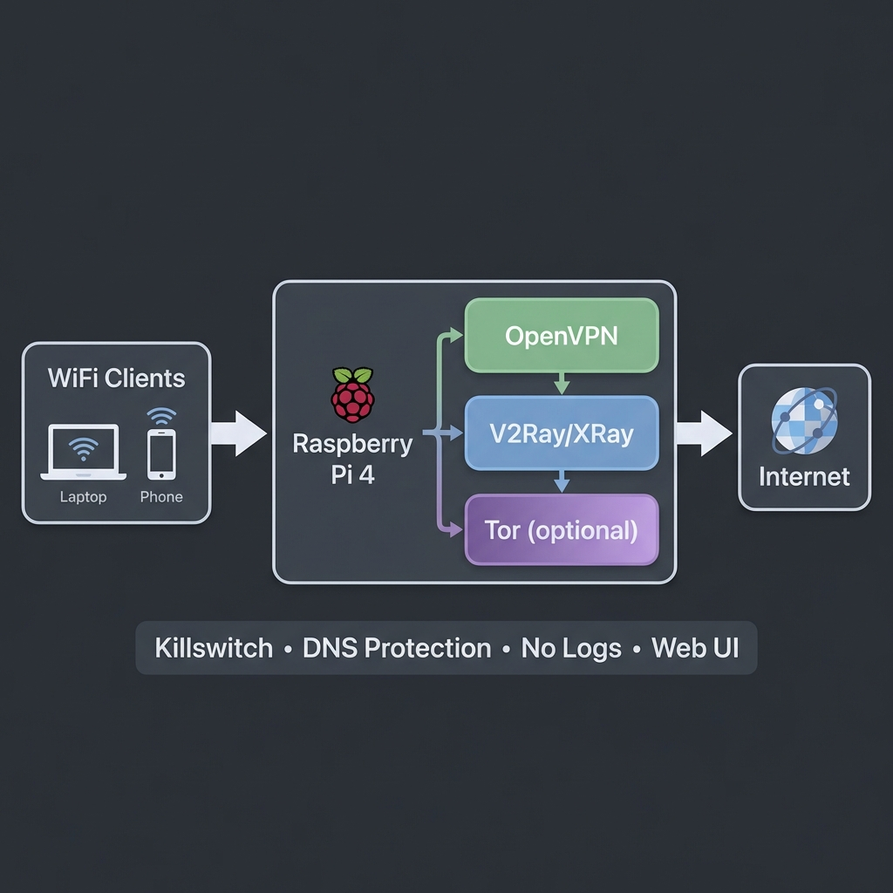

[RU](README.ru.md) · [UA](README.ua.md) · **EN**

# ShadowPi: a privacy router for Raspberry Pi

<p align="center">
  
</p>

ShadowPi turns a Raspberry Pi 4 into a Wi-Fi router that sends every connected device through a VPN and, optionally, an obfuscation proxy. A kill switch blocks traffic whenever the tunnel is down. A Tor layer is planned and currently experimental (see below).

> **Status:** the installer, the firewall scripts and the web panel are tested end to end in a Docker lab that runs the real code on Debian arm64 ([docs/LAB.md](docs/LAB.md): what is real, what is emulated, every check and its result). The project has **not been run on real hardware yet**: Wi-Fi radio, 4G modem and performance are not covered. Known gaps are in [docs/ROADMAP.md](docs/ROADMAP.md). The step-by-step guides 00–11 are in Russian.

## How traffic flows

**Fast mode (default)**

```
Device → Wi-Fi (hostapd) → OpenVPN → V2Ray/Xray proxy → Internet
```

**Paranoid mode (+ Tor): experimental, does not route traffic yet**

```
Device → Wi-Fi → OpenVPN → Tor → V2Ray/Xray proxy → Internet      (design target)
```

`toggle-tor.sh paranoid` and the panel's Tor button start the Tor service, but no firewall rule sends client traffic into Tor. Traffic keeps flowing exactly as in Fast mode. The lab proves this (check T1 in [docs/LAB.md](docs/LAB.md)); real transparent routing through Tor is on the [roadmap](docs/ROADMAP.md).

## Features

| Area | What it does |
|---|---|
| Tunnels | OpenVPN as the base tunnel, V2Ray/Xray for obfuscation. Tor layer: experimental, the service starts but traffic is not routed through it yet |
| Leak protection | iptables kill switch applied at boot before the network: clients and the router itself get out only through the tunnel, the router may contact only the VPN server's own address and port, on any WAN interface. IPv6 disabled. No DNS query logging |
| Uplinks | Ethernet or a USB 4G/LTE modem, with WAN switching (`wan-switch.sh`) and modem setup via ModemManager. The kill switch is tested on modem interface names; automatic failover is not verified (needs hardware) |
| Hotspot | hostapd + dnsmasq, local `anonrouter.local` name |
| Web panel | nginx + PHP control panel on port 8080 |
| Testing | `test-all.sh`: public IP, DNS and IPv6 leaks, service status, VPN and hotspot checks, firewall rules |

## Web panel security

- **Login:** a PHP session login (bcrypt hash set by the installer) behind nginx basic auth. Failed logins are counted on the server per client address, with a growing lockout, so dropping the cookie does not reset them. **Known gap:** nginx basic auth uses the same password and has no lockout, so the password can still be guessed through it (lab check P7, see the roadmap).
- **Sessions:** new session ID at login, `HttpOnly` and `SameSite=Strict` cookie, idle timeout and an absolute lifetime. The panel is plain HTTP for now, so the cookie cannot be `Secure` yet.
- **Default-deny API:** every action needs an authenticated session. Hotspot clients share the router's LAN, so "local network" is not treated as trusted.
- **State-changing actions** accept POST only, with a CSRF token and per-session rate limiting. They report the real result (exit code or service state), not a fixed "success".
- **Least-privilege sudo:** `www-data` may run only a fixed list of `systemctl` units and root-owned scripts (`/etc/sudoers.d/shadowpi`, checked with `visudo`).
- Whitelisted inputs for services, WAN targets and modem setup; shell arguments go through `escapeshellarg`.
- Server text (logs, interface names, messages) is rendered as text, never as HTML.
- Security headers (CSP, `X-Frame-Options`, `nosniff`) and an action log.

## Requirements

| Component | Requirement |
|---|---|
| Hardware | Raspberry Pi 4 (2 GB+ RAM) |
| OS | Raspberry Pi OS Lite 64-bit or DietPi |
| WAN | Ethernet or a USB 4G/LTE modem |
| LAN | Built-in Wi-Fi (`wlan0`) |
| Accounts | An OpenVPN provider config and a V2Ray/Xray server |

## Install

```bash
ssh <user>@raspberrypi.local
git clone https://github.com/Galo12engineer/shadowpi.git
cd shadowpi
sudo bash scripts/master-install.sh
```

The installer asks for the Wi-Fi name and password and the panel password, then sets up the hotspot, nginx + PHP, the scripts in `/opt/shadowpi/scripts`, the sudo rules and the kill switch unit. After that, copy your OpenVPN config (see `docs/03_OPENVPN_SETUP.md`) and reboot.

v2rayA is optional. The installer downloads a pinned release and installs it only if its SHA-256 matches; if that fails it prints a warning and everything else is still installed.

| Panel | URL |
|---|---|
| ShadowPi | `http://anonrouter.local:8080` |
| v2rayA (if installed) | `http://anonrouter.local:2017` |

## Test lab

No Raspberry Pi is needed to check the claims above:

```bash
cd lab && ./lab-test.sh     # needs Docker; builds everything from scratch, takes a few minutes
```

The lab runs the real installer and scripts and tests them from a client's point of view (which IP does a website see, what leaves when the VPN is down, what the panel answers). Results and findings: [docs/LAB.md](docs/LAB.md).

## Repository layout

```
scripts/   install, start/stop, kill switch, Tor toggle, WAN switch, modem setup, tests
web-ui/    control panel (HTML/JS front end, PHP API and auth)
docs/      step-by-step guides 00–11 (hardware → troubleshooting), in Russian; LAB and ROADMAP in English, Russian and Ukrainian
lab/       Docker lab: router, VPN server, test website and client; lab-test.sh
```

## Disclaimer

This is an educational project. Use it in line with the laws of your country and the terms of your VPN and proxy providers.

## License

MIT, see [LICENSE](LICENSE).
