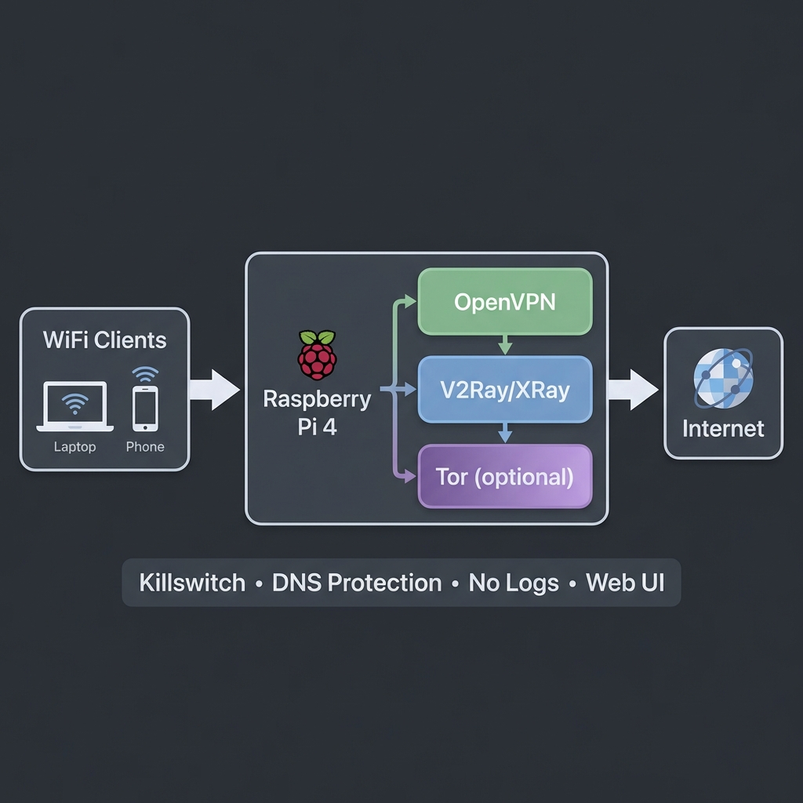

**RU** · [UA](README.ua.md) · [EN](README.md)

# ShadowPi: приватный роутер на Raspberry Pi

<p align="center">
  
</p>

ShadowPi превращает Raspberry Pi 4 в Wi-Fi роутер, который отправляет трафик всех подключённых устройств через VPN и, по желанию, через обфусцирующий прокси. Kill switch блокирует трафик, когда туннель не работает. Слой Tor запланирован и пока экспериментальный (см. ниже).

> **Статус:** установщик, скрипты firewall и веб-панель проверены от начала до конца в Docker-лаборатории, которая запускает настоящий код на Debian arm64 ([docs/LAB.ru.md](docs/LAB.ru.md): что настоящее, что эмулируется, каждая проверка и её результат). На реальном железе проект **ещё не запускался**: Wi-Fi радио, 4G-модем и производительность не покрыты. Известные пробелы — в [docs/ROADMAP.ru.md](docs/ROADMAP.ru.md). Пошаговые гайды 00–11 написаны на русском.

## Как идёт трафик

**Режим Fast (по умолчанию)**

```
Устройство → Wi-Fi (hostapd) → OpenVPN → V2Ray/Xray прокси → Интернет
```

**Режим Paranoid (+ Tor): экспериментальный, трафик пока не маршрутизирует**

```
Устройство → Wi-Fi → OpenVPN → Tor → V2Ray/Xray прокси → Интернет      (цель, не текущее поведение)
```

`toggle-tor.sh paranoid` и кнопка Tor в панели запускают сервис Tor, но ни одно правило firewall не отправляет трафик клиентов в Tor. Трафик идёт точно так же, как в режиме Fast. Лаборатория это доказывает (проверка T1 в [docs/LAB.ru.md](docs/LAB.ru.md)); настоящая прозрачная маршрутизация через Tor стоит в [плане работ](docs/ROADMAP.ru.md).

## Возможности

| Область | Что делает |
|---|---|
| Туннели | OpenVPN как основной туннель, V2Ray/Xray для обфускации. Слой Tor экспериментальный: сервис запускается, но трафик через него пока не идёт |
| Защита от утечек | Kill switch на iptables включается при загрузке до поднятия сети: клиенты и сам роутер выходят наружу только через туннель, роутеру разрешён только адрес и порт самого VPN-сервера, на любом WAN-интерфейсе. IPv6 отключён. DNS-запросы не логируются |
| Каналы связи | Ethernet или USB 4G/LTE модем, переключение WAN (`wan-switch.sh`) и настройка модема через ModemManager. Kill switch проверен на именах интерфейсов модема; автоматический failover не проверен (нужно железо) |
| Хотспот | hostapd + dnsmasq, локальное имя `anonrouter.local` |
| Веб-панель | Панель управления на nginx + PHP, порт 8080 |
| Тесты | `test-all.sh`: публичный IP, утечки DNS и IPv6, состояние сервисов, проверки VPN и хотспота, правила firewall |

## Безопасность веб-панели

- **Вход:** логин через PHP-сессию (хеш bcrypt задаёт установщик) за nginx basic auth. Неудачные попытки считаются на сервере по адресу клиента, с растущей блокировкой, поэтому удаление cookie их не сбрасывает. **Известный пробел:** nginx basic auth использует тот же пароль и не имеет блокировки, так что пароль всё ещё можно подбирать через него (проверка P7 в лаборатории, см. план работ).
- **Сессии:** новый ID сессии при входе, cookie с `HttpOnly` и `SameSite=Strict`, таймаут простоя и общий срок жизни. Панель пока работает по обычному HTTP, поэтому флаг `Secure` для cookie ещё недоступен.
- **API «запрещено по умолчанию»:** каждое действие требует авторизованной сессии. Клиенты хотспота находятся в одной сети с роутером, поэтому «локальная сеть» не считается доверенной.
- **Действия, меняющие состояние,** принимаются только через POST, с CSRF-токеном и ограничением частоты на сессию. Они возвращают реальный результат (код выхода или состояние сервиса), а не постоянный «успех».
- **Минимальные права sudo:** `www-data` может запускать только фиксированный список юнитов `systemctl` и скриптов, принадлежащих root (`/etc/sudoers.d/shadowpi`, проверяется через `visudo`).
- Белые списки для сервисов, целей WAN и настройки модема; аргументы оболочки проходят через `escapeshellarg`.
- Текст от сервера (логи, имена интерфейсов, сообщения) выводится как текст, а не как HTML.
- Заголовки безопасности (CSP, `X-Frame-Options`, `nosniff`) и журнал действий.

## Требования

| Компонент | Требование |
|---|---|
| Железо | Raspberry Pi 4 (от 2 ГБ RAM) |
| ОС | Raspberry Pi OS Lite 64-bit или DietPi |
| WAN | Ethernet или USB 4G/LTE модем |
| LAN | Встроенный Wi-Fi (`wlan0`) |
| Аккаунты | Конфиг OpenVPN-провайдера и сервер V2Ray/Xray |

## Установка

```bash
ssh <user>@raspberrypi.local
git clone https://github.com/Galo12engineer/shadowpi.git
cd shadowpi
sudo bash scripts/master-install.sh
```

Установщик спрашивает имя и пароль Wi-Fi и пароль панели, затем настраивает хотспот, nginx + PHP, скрипты в `/opt/shadowpi/scripts`, правила sudo и юнит kill switch. После этого скопируйте свой конфиг OpenVPN (см. `docs/03_OPENVPN_SETUP.md`) и перезагрузите устройство.

v2rayA — необязательный компонент. Установщик скачивает закреплённый релиз и ставит его, только если совпал SHA-256; если что-то не получилось, он выводит предупреждение, а всё остальное всё равно устанавливается.

| Панель | URL |
|---|---|
| ShadowPi | `http://anonrouter.local:8080` |
| v2rayA (если установлен) | `http://anonrouter.local:2017` |

## Тестовая лаборатория

Чтобы проверить сказанное выше, Raspberry Pi не нужен:

```bash
cd lab && ./lab-test.sh     # нужен Docker; собирает всё с нуля, занимает несколько минут
```

Лаборатория запускает настоящий установщик и скрипты и проверяет их с точки зрения клиента (какой IP видит сайт, что уходит наружу при упавшем VPN, что отвечает панель). Результаты и находки: [docs/LAB.ru.md](docs/LAB.ru.md).

## Структура репозитория

```
scripts/   установка, запуск/остановка, kill switch, переключатель Tor, переключение WAN, настройка модема, тесты
web-ui/    панель управления (фронтенд на HTML/JS, API и авторизация на PHP)
docs/      пошаговые гайды 00–11 (от железа до диагностики) на русском; LAB и ROADMAP на английском, русском и украинском
lab/       Docker-лаборатория: роутер, VPN-сервер, тестовый сайт и клиент; lab-test.sh
```

## Отказ от ответственности

Это учебный проект. Используйте его в соответствии с законами вашей страны и условиями ваших VPN- и прокси-провайдеров.

## Лицензия

MIT, см. [LICENSE](LICENSE).
