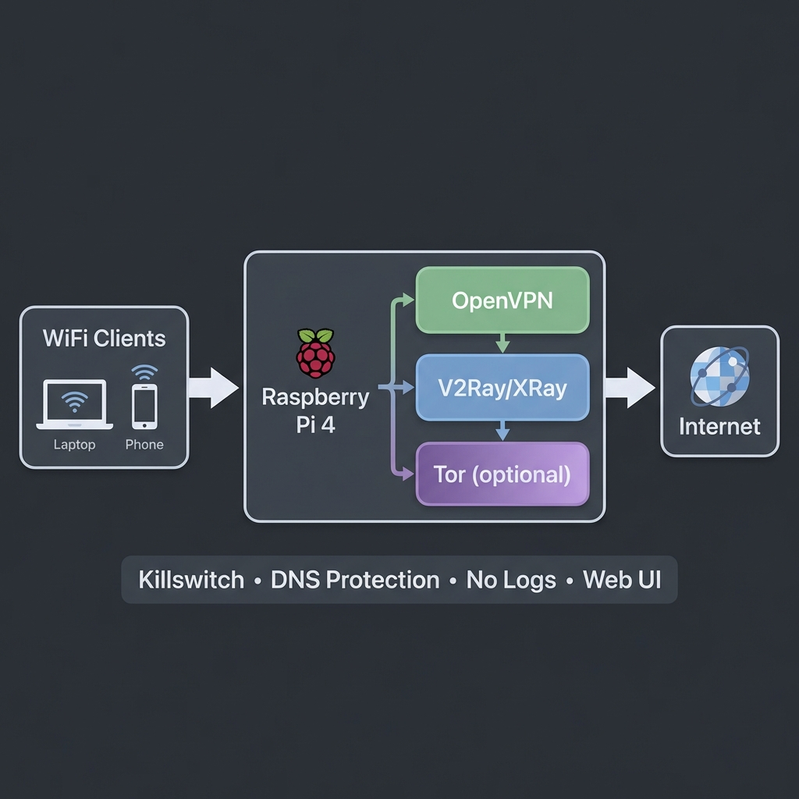

[RU](README.ru.md) · **UA** · [EN](README.md)

# ShadowPi: приватний роутер на Raspberry Pi

<p align="center">
  
</p>

ShadowPi перетворює Raspberry Pi 4 на Wi-Fi роутер, який спрямовує трафік усіх підключених пристроїв через VPN і, за бажанням, через обфускувальний проксі. Kill switch блокує трафік, коли тунель не працює. У режимі Paranoid клієнти йдуть через Tor (див. нижче).

> **Статус:** інсталятор, скрипти firewall і вебпанель перевірено від початку до кінця в Docker-лабораторії, яка запускає справжній код на Debian arm64 ([docs/LAB.ua.md](docs/LAB.ua.md): що справжнє, що емулюється, кожна перевірка та її результат). На реальному залізі проєкт **ще не запускався**: Wi-Fi радіо, 4G-модем і продуктивність не покрито. Відомі прогалини — у [docs/ROADMAP.ua.md](docs/ROADMAP.ua.md). Покрокові гайди 00–11 написано російською.

## Як іде трафік

**Режим Fast (типовий)**

```
Пристрій → Wi-Fi (hostapd) → OpenVPN → V2Ray/Xray проксі → Інтернет
```

**Режим Paranoid (+ Tor)**

```
Пристрій → Wi-Fi → Tor → Інтернет        (сам Tor виходить через тунель OpenVPN)
```

`toggle-tor.sh paranoid` або кнопка Tor у панелі спрямовують у Tor усі TCP-з'єднання клієнтів і весь їхній DNS. Трафік, який Tor не вміє переносити (UDP, ICMP), блокується, а якщо Tor не підключено, клієнти не мають інтернету: на звичайний VPN вони не відкочуються. Лабораторія перевіряє це на справжній мережі Tor (T1, T3, T4 у [docs/LAB.ua.md](docs/LAB.ua.md)).

Не реалізовано: хоп V2Ray/Xray **після** Tor. Вихідний вузол Tor бачить трафік так само, як будь-який вихідний вузол ([план робіт](docs/ROADMAP.ua.md)).

## Можливості

| Напрям | Що робить |
|---|---|
| Тунелі | OpenVPN як основний тунель, V2Ray/Xray для обфускації. Режим Paranoid: TCP і DNS клієнтів ідуть через Tor, а Tor виходить через VPN |
| Захист від витоків | Kill switch на iptables вмикається під час завантаження до підняття мережі: клієнти й сам роутер виходять назовні лише через тунель, роутеру дозволено лише адресу й порт самого VPN-сервера, на будь-якому WAN-інтерфейсі. IPv6 вимкнено. DNS-запити не логуються |
| Канали зв'язку | Ethernet або USB 4G/LTE модем, перемикання WAN (`wan-switch.sh`) і налаштування модема через ModemManager. Kill switch перевірено на іменах інтерфейсів модема; автоматичний failover не перевірено (потрібне залізо) |
| Хотспот | hostapd + dnsmasq, локальне ім'я `anonrouter.local` |
| Вебпанель | Панель керування на nginx + PHP через HTTPS (порт 443, самопідписаний сертифікат) |
| Тести | `test-all.sh`: публічний IP, витоки DNS та IPv6, стан сервісів, перевірки VPN і хотспоту, правила firewall |

## Безпека вебпанелі

- **Вхід:** один вхід через PHP-сесію (хеш bcrypt задає інсталятор). Невдалі спроби рахуються на сервері за адресою клієнта, зі зростаючим блокуванням, тому видалення cookie їх не скидає. Другого запиту пароля в nginx немає: він використовував той самий пароль без блокування, тому його прибрано (перевірка P7 у лабораторії).
- **Сесії:** новий ID сесії під час входу, cookie з `Secure`, `HttpOnly` і `SameSite=Strict`, тайм-аут бездіяльності та загальний термін життя.
- **HTTPS:** панель працює через TLS із самопідписаним сертифікатом, який створює інсталятор; звичайний HTTP на порту 8080 лише перенаправляє й ніколи не приймає пароль.
- **API «заборонено за замовчуванням»:** кожна дія потребує авторизованої сесії. Клієнти хотспоту перебувають в одній мережі з роутером, тому «локальна мережа» не вважається довіреною.
- **Дії, що змінюють стан,** приймаються лише через POST, із CSRF-токеном і обмеженням частоти на сесію. Вони повертають реальний результат (код виходу або стан сервісу), а не постійний «успіх».
- **Мінімальні права sudo:** `www-data` може запускати лише фіксований список юнітів `systemctl` і скриптів, що належать root (`/etc/sudoers.d/shadowpi`, перевіряється через `visudo`).
- Білі списки для сервісів, цілей WAN і налаштування модема; аргументи оболонки проходять через `escapeshellarg`.
- Текст від сервера (логи, імена інтерфейсів, повідомлення) виводиться як текст, а не як HTML.
- Заголовки безпеки (CSP, `X-Frame-Options`, `nosniff`) і журнал дій.

## Вимоги

| Компонент | Вимога |
|---|---|
| Залізо | Raspberry Pi 4 (від 2 ГБ RAM) |
| ОС | Raspberry Pi OS Lite 64-bit або DietPi |
| WAN | Ethernet або USB 4G/LTE модем |
| LAN | Вбудований Wi-Fi (`wlan0`) |
| Облікові записи | Конфіг OpenVPN-провайдера та сервер V2Ray/Xray |

## Встановлення

```bash
ssh <user>@raspberrypi.local
git clone https://github.com/Galo12engineer/shadowpi.git
cd shadowpi
sudo bash scripts/master-install.sh
```

Інсталятор питає ім'я та пароль Wi-Fi і пароль панелі, потім налаштовує хотспот, nginx + PHP, скрипти в `/opt/shadowpi/scripts`, правила sudo та юніт kill switch. Після цього скопіюйте свій конфіг OpenVPN (див. `docs/03_OPENVPN_SETUP.md`) і перезавантажте пристрій.

v2rayA — необов'язковий компонент. Інсталятор завантажує закріплений реліз і ставить його, лише якщо збігся SHA-256; якщо щось не вдалося, він виводить попередження, а все інше однаково встановлюється.

| Панель | URL |
|---|---|
| ShadowPi | `https://anonrouter.local` |
| v2rayA (якщо встановлено) | `http://anonrouter.local:2017` |

Сертифікат панелі самопідписаний, тому браузер один раз попросить його підтвердити. Інсталятор друкує відбиток SHA-256; звірте їх перед підтвердженням.

## Тестова лабораторія

Щоб перевірити сказане вище, Raspberry Pi не потрібен:

```bash
cd lab && ./lab-test.sh     # потрібен Docker; збирає все з нуля, триває кілька хвилин
```

Лабораторія запускає справжній інсталятор і скрипти та перевіряє їх з погляду клієнта (який IP бачить сайт, що виходить назовні, коли VPN не працює, що відповідає панель). Результати й знахідки: [docs/LAB.ua.md](docs/LAB.ua.md). Та сама лабораторія і статичні перевірки (ShellCheck, синтаксис PHP та JavaScript) запускаються в GitHub Actions під час кожного push і pull request.

## Структура репозиторію

```
scripts/   встановлення, запуск/зупинка, kill switch, перемикач Tor, перемикання WAN, налаштування модема, тести
web-ui/    панель керування (фронтенд на HTML/JS, API та авторизація на PHP)
docs/      покрокові гайди 00–11 (від заліза до діагностики) російською; LAB і ROADMAP англійською, російською та українською
lab/       Docker-лабораторія: роутер, VPN-сервер, тестовий сайт і клієнт; lab-test.sh
```

## Відмова від відповідальності

Це навчальний проєкт. Використовуйте його відповідно до законів вашої країни та умов ваших VPN- і проксі-провайдерів.

## Ліцензія

MIT, див. [LICENSE](LICENSE).
